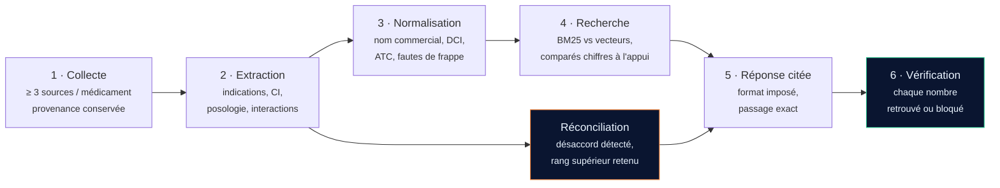

<div align="center">


**Base de connaissances médicamenteuse et assistant à preuves pour le pharmacien d'officine.**

[](https://github.com/KettabAya/pharmeazor/actions/workflows/ci.yml)
[](https://www.python.org/)
[](tests/)
[](LICENSE)

*Projet 2 — Module RCR, M1 IA · Université Constantine 2 Abdelhamid Mehri · Faculté NTIC · Département IFA*

</div>

---

## Le problème

En pharmacie, la bonne information existe presque toujours — mais elle est dispersée. La nomenclature officielle ne contient ni posologie ni indications. Les notices sont des PDF de formats variés, parfois scannés. Les interactions sont publiées à l'étranger. Un pharmacien pressé par un client ouvre cinq onglets pour répondre à une seule question.

Les assistants d'IA génériques n'aident pas : ils répondent avec assurance, mais peuvent inventer une dose, oublier une interaction grave ou confondre deux médicaments aux noms proches. En santé, une réponse sans source, ou avec un chiffre inventé, a des conséquences réelles.

## La règle d'or

> **Une information médicale n'a de valeur que si elle cite sa source, et tout chiffre affiché doit se retrouver tel quel dans cette source.**

Trois conséquences, appliquées partout dans le code :

| Règle | Où elle est appliquée |
|---|---|
| Rien n'est affiché sans source | [`schemas.py`](src/pharmeazor/schemas.py) — `Provenance` est un champ obligatoire, et `Citation` refuse à la construction toute citation dont le texte n'apparaît pas dans le passage |
| Tout chiffre est vérifié mot pour mot | [`number_guard.py`](src/pharmeazor/answer/number_guard.py) — contrôle déterministe, aucun appel modèle |
| L'ambiguïté est signalée, jamais tranchée | [`names.py`](src/pharmeazor/normalize/names.py) — deux candidats trop proches renvoient une `Ambiguity` |

---

## La chaîne



Le chatbot n'est que la dernière brique. L'essentiel du travail est **en amont** (collecter, extraire, normaliser) et **en aval** (vérifier, mesurer).

---

## Démarrage

```bash
git clone https://github.com/KettabAya/pharmeazor.git
cd pharmeazor
python -m venv .venv && source .venv/bin/activate   # Windows : .venv\Scripts\activate
pip install -r requirements.lock.txt
pip install -e . --no-deps
```

> **Toute l'équipe installe depuis `requirements.lock.txt`**, qui fige les
> versions exactes. `requirements.txt` dit *quelles* bibliothèques ; le fichier
> `.lock` dit *quelle version*. Sans lui, deux personnes qui installent à une
> semaine d'intervalle n'exécutent pas le même code, et un bug chez l'un
> n'existe pas chez l'autre. Après tout ajout de dépendance, régénérez-le et
> commitez-le.

Configurer sa clé — **chaque membre crée la sienne**, gratuitement, dans Google AI Studio :

```bash
cp .env.example .env    # puis remplir GOOGLE_API_KEY et PHARMEAZOR_MODEL
```

`.env` est ignoré par git. Une clé ne part **jamais** dans le dépôt ni dans le rapport.

Lancer les tests, puis l'interface :

```bash
pytest
```

```bash
uvicorn pharmeazor.api.main:app --reload --port 8000
```

L'interface est servie sur <http://localhost:8000>. `make help` liste toutes les commandes.

---

## État d'avancement

| Brique | Module | État |
|---|---|---|
| Modèle de données + provenance | `schemas.py` | ✅ implémenté, testé |
| Contrôle des chiffres | `answer/number_guard.py` | ✅ implémenté, testé |
| Normalisation des noms + ambiguïtés | `normalize/names.py` | ✅ implémenté, testé |
| Réconciliation des sources | `reconcile/conflicts.py` | ✅ implémenté, testé |
| Découpage en rubriques | `extract/sections.py` | ✅ implémenté, testé |
| Recherche BM25 (référence) | `retrieve/bm25.py` | ✅ implémenté, testé |
| Lecture des dosages et conditionnements | `normalize/dosage.py` | ✅ implémenté, testé |
| Catalogue, dictionnaire des noms, équivalents | `normalize/catalogue.py` | ✅ implémenté, testé |
| Lecture des classeurs de la nomenclature | `collect/nomenclature.py` | ✅ implémenté, testé |
| Lecture des exports dzair-pharma | `collect/dzair.py` | ✅ implémenté, testé |
| Comparaison des deux sources | `reconcile/crosscheck.py` | ✅ implémenté, testé |
| Registre des sources + conformité | `collect/registry.py` | ✅ implémenté |
| Collecte effective | `scripts/collect.py` | 🚧 semaine 1–2 |
| Lecture PDF / OCR | `extract/` | 🚧 semaine 2 |
| Index vectoriel | `retrieve/` | 🚧 semaine 3 |
| Chaîne de réponse (RAG) | `answer/pipeline.py` | 🚧 semaine 3 |
| Harnais d'évaluation | `scripts/run_eval.py` | 🚧 semaine 3–4 |
| Interface web | `web/` + `api/` | ✅ maquette complète, à brancher |

Les endpoints qui dépendent du corpus répondent `503` avec la marche à suivre plutôt qu'une réponse vraisemblable sans source. C'est volontaire.

---

## Hiérarchie des sources

Du plus fiable au moins fiable. En cas de contradiction, le rang supérieur l'emporte — et le système dit pourquoi.

| Rang | Source | Accès | Remarque |
|---|---|---|---|
| 4 | RCP et notices officiels (ANPP) | manuel | source prioritaire |
| 3 | Nomenclature officielle (Ministère) | manuel | `robots.txt` interdit l'automatisation |
| 2 | Thésaurus ANSM, DailyMed, EMA | manuel | étrangères : **complément, jamais substitut** |
| 1 | Pharm'Net, MEDAlgérie, dzair-pharma | manuel | non officielles, toujours signalées comme telles |
| 0 | Forums, blogs, réseaux sociaux | interdit | écartés du corpus |

Le registre vit dans [`data/reference/source_registry.yaml`](data/reference/source_registry.yaml) et il est **appliqué par le code** : `assert_collectable()` refuse toute collecte automatique sur une source dont le `robots.txt` et les CGU n'ont pas été consignés dans [`docs/DATA_SOURCES.md`](docs/DATA_SOURCES.md).

---

## Les quatre niveaux d'interaction

Classification du Thésaurus de l'ANSM. L'assistant indique **toujours** le niveau et sa source, et ne transforme jamais un niveau léger en rassurance.

| Niveau | Libellé | Signification |
|---|---|---|
| 4 | Contre-indication | l'association ne doit pas être faite |
| 3 | Association déconseillée | à éviter, sauf nécessité |
| 2 | Précaution d'emploi | possible, avec surveillance ou ajustement |
| 1 | À prendre en compte | risque à garder en tête |

« Aucune interaction trouvée » n'est **pas** « sans risque ».

---

## Structure du dépôt

```
pharmeazor/
├── src/pharmeazor/
│   ├── schemas.py            # modèle de données : provenance, citations, conflits
│   ├── config.py             # configuration par variables d'environnement
│   ├── collect/              # registre des sources + conformité robots.txt / CGU
│   ├── extract/              # découpage des notices en rubriques
│   ├── normalize/            # DCI, noms commerciaux, ATC, fautes de frappe
│   ├── retrieve/             # BM25 (référence) + index vectoriel
│   ├── reconcile/            # détection et arbitrage des désaccords
│   ├── answer/               # chaîne de réponse + contrôle des chiffres
│   └── api/                  # application FastAPI
├── web/                      # interface (identité visuelle, splash, plexus)
├── data/
│   ├── raw/ interim/ processed/   # corpus — ignoré par git
│   └── reference/            # registre des sources, liste des médicaments
├── eval/questions.yaml       # jeu de test annoté, rejouable d'un clic
├── scripts/                  # collect · build_index · run_eval
├── tests/                    # 132 tests
└── docs/                     # architecture, sources, évaluation
```

---

## Évaluation

Le projet est noté sur des **chiffres**, pas sur des impressions. Chaque comparaison garde sa trace dans [`docs/EVALUATION.md`](docs/EVALUATION.md) : tableau avant/après, méthode, échantillon.

Mesures suivies :

- **exactitude des citations** — le passage cité contient-il réellement l'information ?
- **rappel du retriever @k** — BM25 contre vecteurs sémantiques
- **couverture des rubriques** — sur un échantillon de 20 notices vérifiées à la main
- **normalisation des noms** — sur au moins 40 noms saisis de différentes manières
- **désaccords retrouvés** — au moins 10 conflits réels annotés
- **taux de refus corrects** — sur les questions hors périmètre
- **appels au modèle** — nombre utilisé, cache compris

---

## Périmètre

**Inclus** — identification et noms, indications, contre-indications, posologie, interactions, effets indésirables, équivalents enregistrés en Algérie, sur 30 à 50 médicaments de trois classes : antalgiques et anti-inflammatoires, antibiotiques courants, antihypertenseurs.

**Exclu** — diagnostic, choix d'un traitement, ordonnance, conseil médical personnalisé, compléments alimentaires, dispositifs médicaux.

Le système aide à **retrouver et contrôler** l'information. La décision reste celle du pharmacien. Les ordonnances de test sont fictives ; aucune donnée de vrai patient n'est utilisée.

---

## Documentation

- [`docs/ARCHITECTURE.md`](docs/ARCHITECTURE.md) — les choix techniques et pourquoi
- [`docs/DATA_SOURCES.md`](docs/DATA_SOURCES.md) — registre des sources, `robots.txt` et CGU consignés
- [`docs/JOURNAL-TRAITEMENT.md`](docs/JOURNAL-TRAITEMENT.md) — ce que l'examen des sources a révélé, avec la mesure et la décision
- [`docs/EVALUATION.md`](docs/EVALUATION.md) — protocole et résultats chiffrés
- [`CONTRIBUTING.md`](CONTRIBUTING.md) — conventions de branche, de commit et de revue

---

## Équipe

| Nom | Rôle | GitHub |
|---|---|---|
| *à compléter* | Collecte et conformité des sources | |
| *à compléter* | Extraction et OCR | |
| *à compléter* | Normalisation des noms | |
| *à compléter* | Recherche et évaluation | |
| *à compléter* | Interface et API | |

Encadrant : **Pr. BOURAMOUL** — Module RCR, M1 IA.

---

## Licence

MIT — voir [LICENSE](LICENSE).

> ⚠️ Projet universitaire. Les contenus produits sont des exemples de démonstration et ne sont pas validés pour un usage professionnel.
